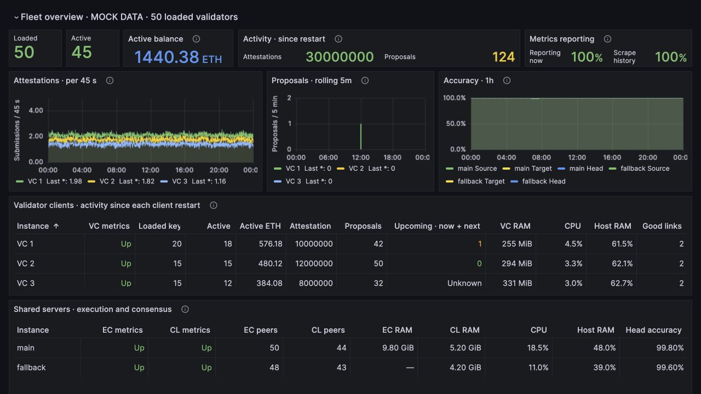
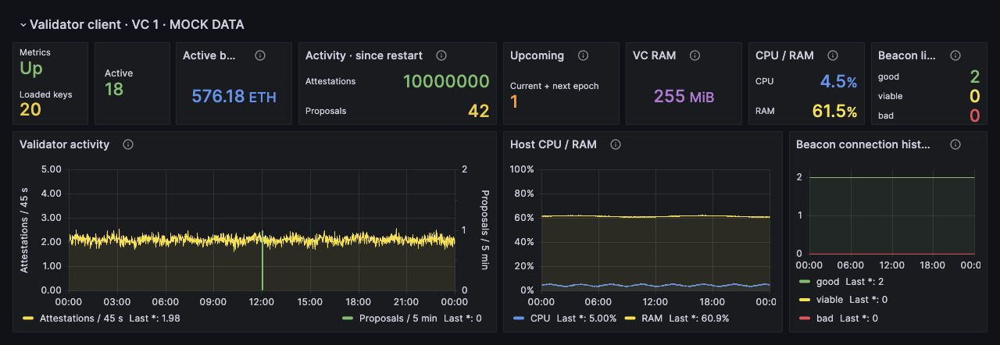

# Upcoming proposal previews

Real Grafana 9.5.18 screenshots with synthetic TestData. The production deployment
uses Grafana 13.2.2; styling can differ. These previews use the production panel
layout, but replace metric queries with mock data and are not live monitoring.





The examples contain 50 loaded validators and full, unabridged activity counters:
10,000,000 attestations for VC 1 and 30,000,000 for the fleet. These are totals
since each client restarted, not the plotted 24-hour activity. Loaded and Active
use narrower cards to leave room for long totals. The client table demonstrates an
upcoming proposal (1, orange), no scheduled proposals (0, green), and an unknown
schedule. The VC 1 card sits between Activity and RAM and shows one upcoming
proposal in the remainder of the current epoch plus the next epoch. Proposal
counts and balances are illustrative, not predictions for these fictional keys.

Regenerate mock dashboards with:

```sh
python3 monitoring/previews/upcoming-proposals/build-preview.py --output /tmp/lido-proposal-dashboards
```

Provision a TestData datasource with UID `lido-mock` and import the generated JSON.
No private deployment configuration or actual validator public keys are used.
