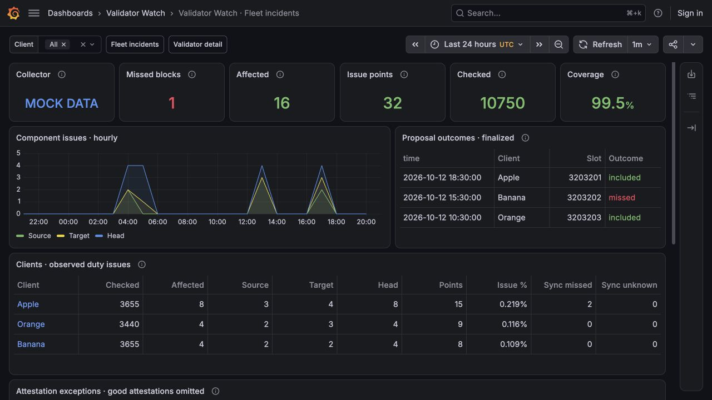

# Validator Watch

A separate duty-history application alongside [Lido Grafana](../lido-grafana/README.md).
It reads a designated beacon node, keeps 30 days of local history, and provides two
Grafana dashboards plus optional Discord notifications for missed proposals, repeated attestation
issues and collection failures.

**Initial implementation:** automated outcome tests and mock-dashboard previews are
provided. Live API compatibility, node cost and sustained operation must still be
checked on your deployed beacon version before relying on its results.

## What is recorded

| Observation | Stored result |
| --- | --- |
| Attestation earns all three flags | Summary count only; no individual event |
| Missing source, target or head credit | One exception with flags and 1–3 component-issue points |
| Owned block proposal | Included or missed outcome, slot and scheduled time |
| Sync committee participation | Expected, absent and unknown committee-position counts |
| Unavailable evidence | Collection gap/paused state; never a fabricated missed duty |

Source/target/head are **participation credit**, not independent messages a validator
sends. A failed flag does not prove that nothing was submitted. Scores weight the
three flags equally for troubleshooting; they are not estimates of lost ETH.
Client tables show affected attestations separately from component points.

The fleet dashboard has summary cards, a thin-line component chart, proposal history,
client rankings, attestation exceptions, collection coverage and Discord delivery.
Click a client or an exception's validator to open the detail dashboard. Tables
sort by clicking column headings. Client and validator filters accept multiple values.



## Getting started

Use a Linux monitoring host with access to the **fallback beacon REST API** and
public-key inventories. No signing keys, validator keymanager access, execution RPC
or additional child services are needed. Existing metrics-only SSH tunnels to
validator children are not used by this collector.

This application has its **own standalone Compose file**. You do not need the
Lido Grafana deployment or a checkout of this repository. Keep `compose.yml`,
`.env` and your inventory CSVs in one deployment directory; configuration and
dashboards are supplied by the image.

Download `compose.yml` and `.env.example` into that directory, then:

```sh
cp .env.example .env
chmod 600 .env
mkdir -p inventory
```

Edit `.env`:

- `WATCH_IMAGE`: a published version. `validator-watch/v…` tags release this app alone;
  repository-wide `v…` tags release both apps.
- `BEACON_URL`: the designated fallback REST endpoint, for example
  `http://127.0.0.1:5552` through an existing tunnel.
- `PRIMARY_HEALTH_URL`: optional readiness guard. Leave empty to disable it.
  If configured and unavailable/unready, analysis pauses. Analytics never switch
  to the primary automatically.
- `GRAFANA_ADMIN_PASSWORD`: a unique password for this Grafana instance.
- `DISCORD_WEBHOOK_URL`: your webhook between single quotes; leave empty to disable
  Discord. All normal configuration, including credentials, can stay in `.env`.
- `ATTESTATION_ISSUE_PER_THOUSAND=10` and `ATTESTATION_ISSUE_EPOCHS=2`: alert when a
  client's affected-duty rate is at least 10 per 1,000 (1%) in each of two consecutive checked
  epochs. The epoch setting also controls recovery persistence.
- `COLLECTOR_ALERT_AFTER_SECONDS=300`: alert after five minutes of collection
  failure while the process is still running.

Place one CSV per client in `inventory/`, such as `Apple.csv`, `Banana.csv` and
`Orange.csv`. Each file contains **one public key per line, without a header**.
Names may contain letters, digits, `_` and `-`; they appear in Grafana. Duplicate
keys anywhere in the inventory are rejected. This initial collector accepts up to
2,048 keys per instance to stay within its request budget. The existing Lido Grafana inventory
format can be reused. Files must be readable by container UID 65532.

Run the [compatibility probe](#compatibility-probe) before enabling continuous
collection. Once its results and node load are acceptable:

```sh
docker compose up -d
docker compose logs --tail=30 collector
```

The collector starts with the current epoch, captures ownership, and waits until
its full inclusion window is finalized. Expect an initial delay of several epochs.
Missed epochs enter a durable recovery queue. Recent finalized epochs take priority;
older epochs are retried one at a time with a ten-minute rest between historical
attempts by default. Ownership is frozen at the first
inventory observation during each epoch. Move keys between files at an epoch
boundary where possible; within-epoch moves cannot be represented by this format.
Previously stored events retain their original client attribution. Once chain timing
has been established, inventory observations continue during beacon outages.
Epochs when the collector itself was stopped can lack ownership observations;
they require an explicit historical inventory confirmation before analysis.

Grafana binds to `127.0.0.1:3306` by default. Access it through your usual private
connection. It reads SQLite locally; dashboard refreshes issue no beacon requests.
This Compose creates a separate Grafana and database, independent of Lido Grafana.
It installs the signed `frser-sqlite-datasource` plugin, pinned to 4.0.6, at startup;
the initial launch therefore needs access to Grafana's plugin registry.

Named volumes preserve the database, provisioned dashboards and Grafana settings.
Do not use `docker compose down -v` unless you intend to delete that history.
Summary buckets are hourly: selections include the whole first partial hour,
while individual events use exact time filters. Retention can retain up to one
additional hour of summaries. SQLite reuses freed pages; its file need not shrink
immediately after pruning. Retention bounds time, not a fixed disk-byte budget.

## Slow catch-up and existing gaps

`BACKFILL_INTERVAL_SECONDS=600` sets the minimum rest **after** each historical
attempt (range 60–86400). Each polling cycle attempts at most one epoch, with
recent finalized work taking priority. There is no concurrent beacon scanning.
Failed historical epochs receive exponential retry delays up to six hours; other
eligible epochs can proceed. Restarting the container preserves the queue and
cooldowns. An already running historical request is not interrupted when a new
epoch becomes eligible, so it can delay recent work by up to one bounded attempt.

The coverage table stays **unknown** until a complete epoch has been checked.
Its separate proposal coverage can become **checked** sooner: proposal outcomes
and missed-block notifications are saved before attestation committee analysis.
A committee timeout therefore does not erase a proven missed proposal. Historical
missed-block messages are labelled as catch-up and include the original slot time.
Retries do not enqueue the same proposal alert again. Recovered attestation history
updates tables and charts, but does not replay old threshold/recovery notifications
or rewind the current alert streak.

The **Recovery queue** table shows pending epochs, inventory availability,
proposal coverage, attempts and retry times, including entries outside the dashboard
selection. Collection health describes recent work; a healthy collector can still
have a historical backlog. Historical blocks/duties/committees must remain available
on the designated beacon. Pruned or unsupported history stays unknown and queued;
recovery is not guaranteed solely by retaining a job.

Older releases wrote `catchup_limit` gaps and discarded their ownership lists.
The upgrade retains these gaps, but cannot infer where keys belonged in the past.
If your mounted CSVs correctly describe a historical interval, explicitly queue it:

```sh
docker compose exec collector python -m watch.main backfill \
  --from-epoch 123456 --to-epoch 123470 --confirm-inventory
```

Replace the sample epoch numbers with the actual gap. The upgraded collector must
have started once to record chain timing. This command uses the CSVs mounted at
`/inventory`, skips completed epochs and preserves any previously captured ownership.
Use separate ranges with the appropriate inventory if keys moved between clients.
Do not confirm today's CSVs for a period when their ownership was different.
The command queues work; it does not issue an immediate burst of beacon requests.

Unresolved queue entries and their proposal evidence are exempt from normal
retention. Completed history still follows `RETENTION_DAYS`; recovering an epoch
older than that period will not extend its history retention. Increase retention
before recovering older history if you want to inspect it afterwards. Proposal
notification identifiers are retained to prevent repeated alerts across retries
and explicit requeues. Monitor disk usage if a backlog remains unresolved for a
long time. Pending Discord messages are retained until delivery or terminal failure.

## Discord webhook

Discord is optional and disabled by default. In `.env`, set:

```ini
DISCORD_WEBHOOK_URL='https://discord.com/api/webhooks/REPLACE_ID/REPLACE_TOKEN'
ATTESTATION_ISSUE_PER_THOUSAND=10
ATTESTATION_ISSUE_EPOCHS=2
COLLECTOR_ALERT_AFTER_SECONDS=300
```

Use your actual Discord webhook URL. Run `docker compose up -d` again to apply
changed environment settings. Keep `.env` private and out of Git; credentials in
environment variables are visible to administrators who can inspect containers.
The app does not print the URL in its logs or store it in SQLite. Only official
HTTPS `discord.com/api/webhooks/...` URLs are accepted.

If you prefer a mounted secret file, leave `DISCORD_WEBHOOK_URL` empty, create
`secrets/discord-webhook` containing the URL, make it readable by UID 65532, and set
`DISCORD_WEBHOOK_FILE=/run/secrets/discord-webhook`. The mount is read-only. Setting
both URL and file is rejected. With the normal `.env` setup, Compose creates an
empty optional `secrets/` directory automatically; no secret file is required.

| Condition | Default notification |
| --- | --- |
| Confirmed missed proposal | Every missed proposal, with client, public key, slot, scheduled and detection times |
| Repeated attestation issues | At least 10 affected duties per 1,000 in **each of two consecutive checked epochs**, per client |
| Several clients cross together | One grouped fleet notification; shared-cause diagnosis is not assumed |
| Attestation recovery | Two consecutive checked epochs below 10 per 1,000 |
| Collection unavailable | One alert after 300 seconds of sustained failure while the collector runs |
| Collection recovery | One message when recent collection resumes; historical recovery continues separately |

An affected attestation is missing **any** source, target or head credit. Each duty
counts once in the rate, even when all three flags are absent. With 200 active
validators, two affected duties per epoch equal 10 per 1,000. With 50 active validators,
one affected duty is 20 per 1,000. The denominator uses checked active duties, not loaded keys
or an assumed 99% host uptime. These alerts use exact per-epoch results, independent
of the dashboard's hourly summary buckets and time-range selection.

The threshold accepts decimals greater than zero and up to 1,000. Set `10` for 1%,
`5` for 0.5%, or `1` for 0.1%; lower values are more sensitive. It is a normalized
rate, so the client does not need 1,000 validators.

Ongoing incidents do not send a new message every epoch. Alert state and the outbox
survive restarts. Gaps and epochs without duties break the consecutive-epoch streak;
they cannot establish recovery. Clients crossing the threshold in different epochs
may produce separate messages. If Discord is enabled during an ongoing attestation
incident, the next qualifying checked epoch can announce it once. No healthy
attestation events are individually stored.

The outbox retries transient failures and rate limits, up to ten attempts.
Permanent failures appear in Grafana's delivery table. A crash after Discord accepts
a message but before the database commit can produce a duplicate; delivery is
at-least-once. `@everyone` and automatic mentions are disabled.

Duty alerts are **confirmed after finalization of the inclusion window**, not
immediate alarms. Previously observed missed proposals while Discord was disabled
are not retroactively queued. Pending alerts pause while disabled.

A stopped collector or an offline monitoring server cannot send its own alert.
Use an independent external uptime/heartbeat monitor for that case; this Compose
file does not create one.

## Evidence and operating limits

This version supports mainnet timing (32 slots/epoch, 12 seconds/slot) and Deneb,
Electra and Fulu blocks. Unsupported forks, missing duties, malformed bitfields,
optimistic data, stale finality and incomplete API responses pause analysis.

It selects a canonical header at or below the verified finalized height, close to
the epoch's inclusion window, then follows parent roots to prove skipped slots;
a standalone HTTP 404 cannot establish a missed proposal. It reads blinded blocks,
filtered validator records, committee mappings and duties, combines Electra's
committee bitfields correctly, and unions credit across valid inclusions. The
node's canonical consensus validation is trusted; this is not an independent
consensus verifier. It rechecks that canonical anchor before saving proposals and again before committing a complete epoch.

Sync statistics count committee **positions**, including duplicate assignments.
An absent inclusion block creates unknown positions, not failures blamed on the
committee. Exact validator submission or relay timing is unavailable from this
chain data. Diagnosing causes still requires separately obtained client/relay logs.

Requests are sequential with at least a one-second pause between responses, a
180-request budget per polling cycle, a 300-second cycle budget checked before
each request, 10-second socket timeouts, and 4 MiB per-response limits. An in-flight
request can extend the cycle. A typical epoch involves dozens of block reads plus
committee lookups, shared across the fleet. This can still cause meaningful beacon
CPU/disk work; a timeout does not cancel server-side work. Test on the fallback and
observe its load before enabling continuous operation. Polling sleeps 30 seconds
between cycles. No whole-state or whole-validator-registry downloads are requested.

Coverage is shown separately: checked epochs, queued/unknown epochs and unregistered keys.
Coverage percentages describe attempted epochs in the selected range, not time
before installation. A stale/unknown collector must not be interpreted as a healthy
fleet. SQL tables show at most 200 exceptions/rankings per query. Only trusted
Grafana administrators should have datasource-editing privileges.

## Compatibility probe

Validator identity and activation/exit epochs are read in batches from a pinned
recent finalized state before scanning blocks. Activity is evaluated against the
epoch being checked, including validators that have since exited. Attestations,
committees and proposal duties still use their historical epoch; historical
balances are not queried. Inventory keys absent from the finalized registry are
reported as unknown coverage.

Network failures identify the beacon role (`collection` or `primary_health`),
endpoint category, method, error type, elapsed request time and request number.
URLs, pubkeys and request bodies are omitted. A successful compatibility probe
does not rule out timeouts in historical requests or full inventory batches.

Before live collection, run the bounded diagnostic on the monitoring host:

```sh
docker compose run --rm --no-deps collector probe --beacon-url http://127.0.0.1:5552
```

Optionally add `--validator-index 12345` with one of your indices to test attester
access. This is a diagnostic, not a proof of full outcome correctness or low node
cost. Nimbus v26.2.0 lacks the standard attestation-reward route in its reward
module; the collector instead derives participation flags from canonical inclusion.

## Local development and screenshots

```sh
python3 -m unittest discover -s tests -v
python3 grafana/build_dashboards.py
docker build -t validator-watch:local .
```

Set `WATCH_IMAGE=validator-watch:local` for a locally built deployment. No new
release is published merely by building or editing these files.

Synthetic data can be generated into a **new, disposable database**:

```sh
DATABASE_PATH=/tmp/watch-demo.sqlite python3 -m watch.main demo
```

It contains 50 fictional validators across Apple, Banana and Orange. Demo generation
never opens a beacon connection or delivers a webhook. The saved
[preview screenshots](previews/README.md) are rendered by Grafana from this data.

References: [Beacon API specification](https://ethereum.github.io/beacon-APIs/),
[Deneb participation rules](https://ethereum.github.io/consensus-specs/specs/deneb/beacon-chain/#get_attestation_participation_flag_indices),
[Nimbus REST guidance](https://nimbus.guide/rest-api.html),
[Discord webhooks](https://docs.discord.com/developers/resources/webhook).
